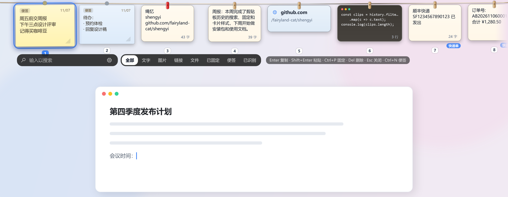
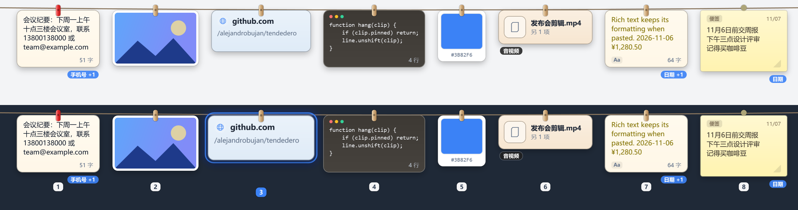
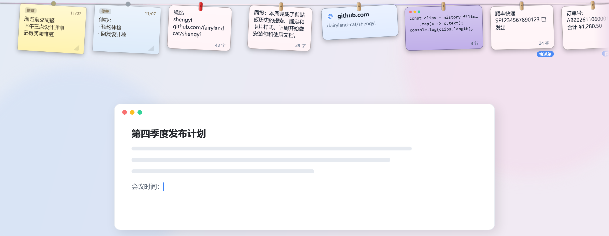
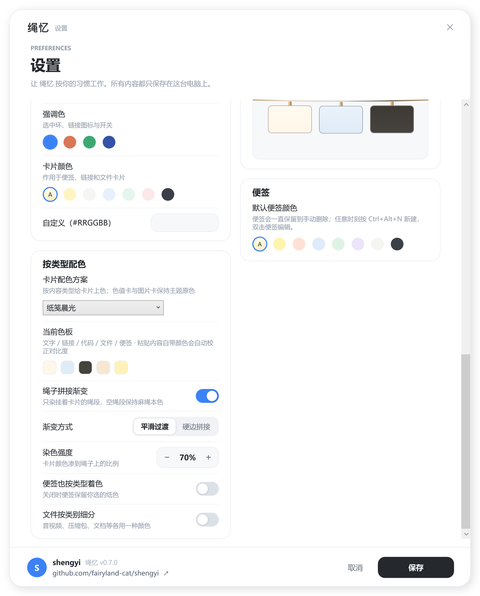
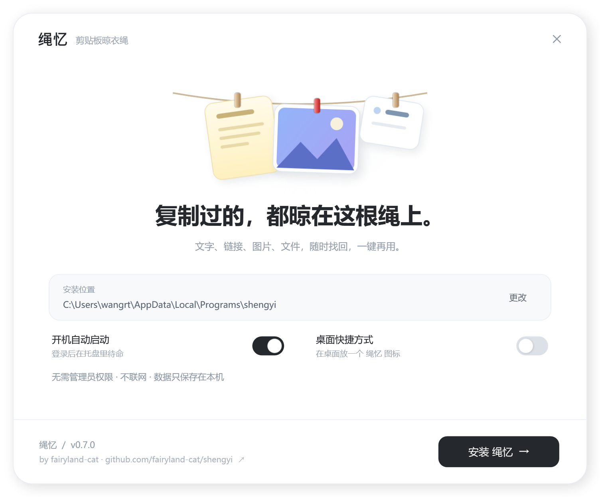
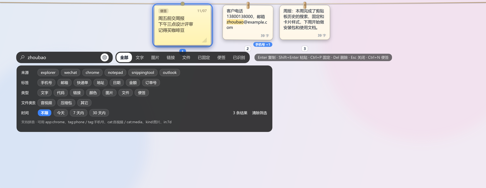
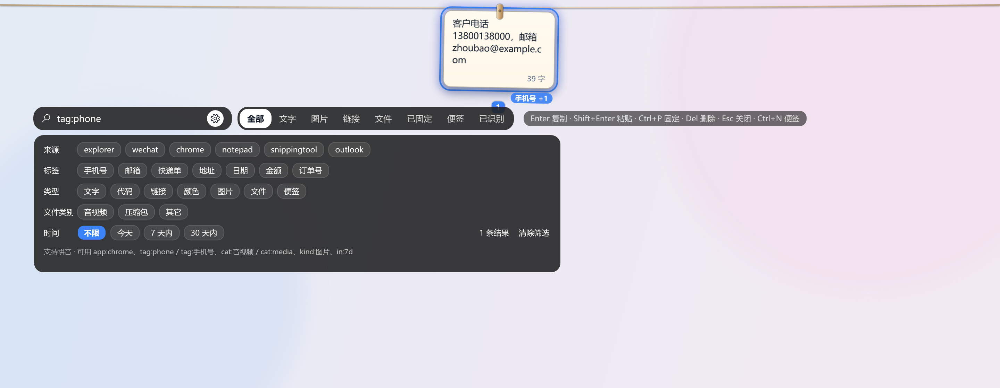
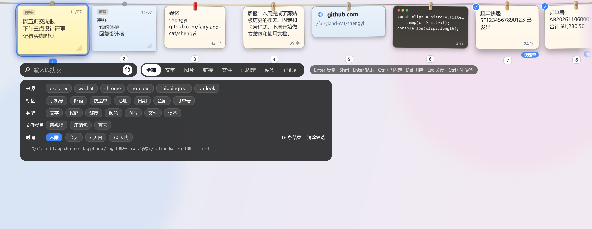
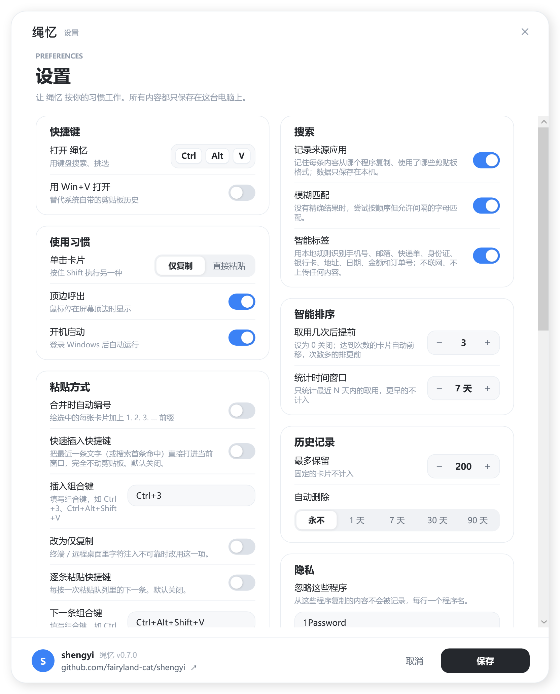

# 绳忆 (shengyi)

> **致谢**：绳忆的「晾衣绳」交互灵感来自 [Tenderedo](https://github.com/alejandrobujan/tendedero)——[Alejandro Buján](https://github.com/alejandrobujan) 做的 macOS 小工具：截过的图像像照片一样挂在屏幕顶部的晾衣绳上。这个点子太可爱了，可惜只有 Mac 版。绳忆把它带到了 Windows，并扩展了主题配色、按取用频率排序、便签等功能。
>
> 内置拼音码表来自 [mozillazg/pinyin-data](https://github.com/mozillazg/pinyin-data) 的《通用规范汉字表》读音数据（MIT，© 2016 mozillazg），仅用于本地全拼 / 首字母检索。

**把剪贴板历史晾在一根绳上。**



在 Windows 上复制的东西，包括文字、链接、代码、颜色、图片、文件，都会变成一张卡片，挂在屏幕顶部的细绳上。
鼠标停在屏幕顶边就能看到；按快捷键可以用键盘搜索、选择、粘贴。

## 功能

- **一种内容一种卡片**：文字是暖黄纸片，代码是深色代码卡，链接显示域名，颜色值直接变色卡，图片是相框，文件是文件卡。
- **便签**：随时新建一张常驻便签，双击编辑、右键换纸色；便签永远挂在最左边，不会被自动清理，也不参与智能排序。
- **不重复**：再次复制已有的内容，原来那张卡片回到最前面。
- **固定常用内容**：固定的卡片用红色夹子排在最左边，永远不会被自动清理。
- **智能排序**：卡片在最近 N 天内被取用达到设定次数（默认 7 天 / 3 次）后自动前移，多张达标的按次数从高到低排；阈值和窗口天数都能改，设为 0 关闭。
- **快速搜索与定位**：内存全文索引，支持拼音全拼 / 首字母、模糊匹配，按来源应用、内容类型、时间范围筛选，结果按匹配度排序。
- **智能标签**：本地规则自动识别手机号、邮箱、快递单、身份证 / 银行卡、地址、日期、金额与订单号，卡片角标一眼可见，也能按标签筛选；**不联网、不上传、不调用任何云端 AI**。
- **图片原格式保真**：PNG / JPEG / GIF / WebP / BMP 的原始字节按原格式保存并原样写回剪贴板，不再一律重编码成 PNG。
- **文件分类**：音视频、压缩包、文档、图片文件等带类别角标，可按类别筛选或搜 `cat:音视频`。
- **一次拿走多条**：Ctrl+单击多选后合并复制 / 合并粘贴、逐条粘贴队列、完全不动剪贴板的快速插入。
- **键盘模式**：直接打字搜索，按分类筛选，Ctrl+1…9 直接取用。
- **可选接管 Win+V**：替代系统自带的剪贴板历史。
- **外观可调**：5 套主题（暖纸 / 冷银 / 亚麻 / 瓷白 / 石墨）、4 种强调色、自定义卡片颜色（可填 `#RRGGBB`）、绳子弧度与卡片大小；设置窗口里有实时预览。默认配色与旧版完全一致。
- **按类型配色 + 绳子拼接渐变**：10 套色板，文字 / 链接 / 代码 / 文件 / 便签各一种颜色；绳子只把当前视口里挂着卡片的绳段染成对应颜色，相邻卡片之间平滑过渡，空绳段保持麻绳本色，滚动时渐变跟着走。**色值卡与图片卡不染色**（外框保持主题色、内部真实内容不变）；粘贴内容自带的文字 / 背景颜色会被识别，并按 WCAG 实测对比度自动校正到 ≥ 4.5:1，不会和卡片配色打架。默认关闭，在 **设置 → 按类型配色** 里开启。
- **隐私**：不需要账号、不联网、不收集任何数据；默认忽略常见密码管理器；可以随时暂停记录。
  所有内容都只保存在本机 `%LOCALAPPDATA%\shengyi`。





按类型配色提供 10 套方案（纸笺晨光、银灰冷调、亚麻大地、青花瓷、马卡龙、莫兰迪、霓虹暗夜、终端极客、无障碍高对比、光谱彩虹），可切换平滑 / 硬边拼接、调节染色强度，并可选择是否让便签也参与着色、是否把文件按类别细分。便签默认保留你自己选的纸色。上图是「马卡龙」方案 + 90% 染色强度。

<p align="center"></p>

## 安装

在 [Releases](../../releases) 下载：

- `shengyi-Setup-x.y.z.exe`：安装程序，不需要管理员权限；
- `shengyi-x.y.z-portable.exe`：便携版，单个 exe，放哪儿都能运行（自带 .NET 运行时）。

要求 Windows 10 1809 及以上的 64 位系统。

<p align="center"></p>

> 程序还没有代码签名，第一次运行时 Windows 可能提示"已保护你的电脑"，点 **更多信息 → 仍要运行** 即可。

## 版本

绳忆使用 `主版本.次版本.修订号`：**每次新增功能都会提升次版本号**，只修缺陷升修订号，破坏性变更升主版本；
不会复用或覆盖已发布的版本。当前版本、完整变更记录与发版清单见 [CHANGELOG.md](CHANGELOG.md)。

下载文件名里的 `x.y.z`、关于窗口和安装程序窗口显示的版本号，都来自 `shengyi.csproj` 的 `<Version>`。

## 使用

| 鼠标 | |
|---|---|
| 停在屏幕顶边 | 在这块屏幕上显示晾衣绳 |
| 单击 | 复制（Shift+单击：粘贴到当前窗口） |
| Ctrl+单击 | 多选卡片（左上角出现勾选），用于合并 / 逐条粘贴 |
| 双击 | 打开：图片用看图软件，链接用浏览器，文字进编辑窗口 |
| 按住 | 编辑（图片用画图，文字用编辑窗口） |
| 中键 | 快速查看 |
| 右键 | 粘贴、粘贴为纯文本、快速插入这一条、固定、编辑、另存为、删除…（多选时多出合并与逐条粘贴） |
| 双击 / 右键便签 | 编辑内容 / 更换纸色、删除（删除前有确认） |
| 拖出 | 拖一份副本到任意程序或文件夹 |
| 滚轮 | 沿着绳子左右滚动 |

| 键盘模式（默认 **Ctrl+Alt+V**，开启后也可用 Win+V） | |
|---|---|
| 直接打字 | 全文搜索（多个词用空格隔开，需同时命中） |
| 搜索框右侧的齿轮 | 展开高级筛选：来源应用、智能标签、内容类型、文件类别、时间范围 |
| ← → | 选择 |
| Enter / Shift+Enter | 复制 / 粘贴到原来的窗口 |
| Ctrl+1…9 | 直接使用对应的卡片 |
| Ctrl+M / Ctrl+Shift+M | 合并多选卡片到剪贴板 / 合并并粘贴（可在设置里开自动编号） |
| Tab | 切换分类（全部、文字、图片、链接、文件、已固定、便签、已识别） |
| Ctrl+P · Ctrl+E · 空格 · Del | 固定 · 编辑 · 快速查看 · 删除 |
| Ctrl+N | 新建便签（绳子隐藏时也可用全局 **Ctrl+Alt+N**） |
| Esc | 关闭 |

托盘菜单 →「新建便签…」也是同样的入口，菜单上会显示 Ctrl+Alt+N（若该组合未被其它程序占用）。

托盘图标 → 设置：修改快捷键、开启 Win+V、把单击改为粘贴、是否记录来源应用、开启模糊匹配与智能标签、粘贴方式（两个可选全局快捷键、自动编号、自动间隔、仅复制回退）、智能排序的阈值与统计窗口、默认便签颜色、最多保留条数和保留天数、要忽略的程序、开机启动，以及外观（主题、强调色、卡片颜色、绳子弧度、卡片大小）。
托盘菜单还可以暂停记录、清空历史、重置使用统计。

外观设置里的「绳子弧度」控制绳子中部的下垂量，卡片会沿着弧线挂；「卡片大小」按百分比等比缩放卡片及其间距。加大这两项时，顶部透明条与键盘工具条会自动加高，不会裁切卡片。
深色主题（石墨）会同时作用于晾衣绳、卡片、快速查看和设置窗口本身。改动保存后立即生效，不需要重启。

### 搜索与筛选

进入键盘模式后直接打字即可搜索。检索跑在内存索引上，`clips.json` 仍是唯一数据源，索引可以随时重建——不引入数据库，也不需要联网：

- **全文**：文字、链接、代码、颜色值、文件名、图片卡（搜「图片」也能找到）、富文本中被 HTML 标签包住的可见文字、来源程序名、剪贴板格式和类型词都会被索引。
- **拼音**：内置《通用规范汉字表》8105 字的读音表，搜 `zhoubao` 或 `zb` 都能找到「周报」；`ü` 同时支持 `u` / `v` 两种写法。
- **模糊**：完全没有精确命中时，退化为按顺序、允许间隔的字母匹配（可在设置里关闭）。
- **高级筛选**：点搜索框右侧的齿轮展开抽屉，按来源应用、**智能标签**、内容类型、**文件类别**、时间范围（今天 / 7 天 / 30 天）组合筛选，右下角显示结果条数；展开时顶部透明条会自动加高。标签行和类别行都只列出当前历史里确实出现过的值。
- **搜索语法**：`app:chrome`、`kind:图片`、`tag:phone`（也认 `tag:手机号` / `tag:手机`）、`cat:media`（也认 `cat:音视频` / `cat:video`、`cat:archive` / `cat:压缩包`）、`in:7d`，可与关键词或抽屉里的选择叠加。
- **排序**：有关键词时按匹配度排序（命中越靠前分越高），只做筛选时仍用智能排序；固定卡片和便签永远在最左边。卡片上直接命中的文字会高亮，拼音命中是语义匹配，不改动原文。
- **隐私**：来源应用与剪贴板格式默认记录，可在 设置 → 搜索 里关闭；关闭后不再写入新记录，已有条目的筛选仍可用。



### 智能标签与来源

复制内容时，绳忆在**本机**用正则和校验位判断里面有哪些常见实体，把结果写成一张卡片的标签。没有网络请求、没有模型、没有密钥，也不会改变原文；标签只是 `clips.json` 里几个可选字段，关闭开关后会自动清掉由程序生成的标签（手工写入的其它标签保留）。

| 标签 | 识别方式 |
|---|---|
| 手机号 | 中国大陆 11 位 `1[3-9]…`，允许空格或短横线分隔 |
| 邮箱 | 常规邮箱格式 |
| 快递单 | 常见前缀（`SF` / `YT` / `ZTO` / `JD` / EMS `AA123456789CN`），或「快递 / 运单 / 单号」附近的长字母数字串 |
| 身份证 | 18 位，按 **GB 11643** 加权校验位验证，并校验出生日期合法 |
| 银行卡 | 16–19 位，按 **Luhn** 校验，允许每四位空格分隔 |
| 地址 | 中文串里同时出现行政区后缀（省 / 市 / 区 / 县 / 镇…）与门牌后缀（路 / 街 / 号 / 栋 / 室…） |
| 日期 | `2026-11-06`、`2026年11月6日`、`11月6日` |
| 金额 | `¥1,280.50`、`300 元`、`USD 20` |
| 订单号 | 「订单号 / 交易号 / order no」后面的 6–32 位编号 |

校验位会把随手敲的 18 位数字、不满足 Luhn 的长数字挡掉，避免「看起来像」就乱贴标签。文件名也会参与识别（例如 `发票_2026-11-06.pdf` 会带「日期」）。

识别结果有三个去处：卡片右下角的角标（多个时显示 `+N`，鼠标悬停看全部）、齿轮抽屉里的标签行、以及 `tag:phone` 这样的搜索语法和「已识别」分类 Tab。快速查看（中键 / 空格）底部会显示来源程序、全部标签和复制时间，卡片 Tooltip 同样会显示来源。

历史里在升级前就存在的条目，在启用该功能后也会被重新识别，**不会改变它们的顺序**；在 设置 → 搜索 → 智能标签 可以整体关闭。



> 这里刻意没有接云端 AI：这九类实体用本地规则就能判定得很准，而绳忆的承诺是「不联网、不收集数据」。

### 多格式保真与批量粘贴

**图片**：以前所有图片都会用 `PngBitmapEncoder` 重存一遍，动图只剩第一帧、透明通道与压缩方式也可能变化。现在捕获时先读剪贴板上的 `PNG` / `JFIF` / `GIF` / `image/webp` 等格式，把**原始字节**按对应扩展名存进 `Images\`，取用时把同一种格式写回剪贴板（并同时给出 `CF_BITMAP` 以兼容只认位图的程序）。GDI+ 无法解码的格式（如 WebP）仍以原格式写回；`CF_DIB` 这类没有文件头的数据走原来的 GDI+ → PNG 路径。升级前的图片没有格式字段，一律按 PNG 读取，行为不变；「另存为」和拖出会沿用真实扩展名。

**文件卡**：按扩展名给每张文件卡一个粗类别——音视频 / 压缩包 / 文档 / 图片文件 / 文件夹 / 其它——显示在卡片左下角。类别名（中英文都行）进入全文索引，也能在齿轮抽屉里点选，或直接搜 `cat:音视频`、`cat:archive`。分类只看文件名，不打开、不解析文件内容；升级时旧文件卡会自动补算类别，**顺序不变**。

**多选**：键盘模式下按住 Ctrl 单击卡片即可多选，左上角出现勾选角标；再点一次取消，右键菜单有「清除多选」，收起绳子也会清空（避免看不见的选择残留）。多选后右键菜单会多出四项：

| 操作 | 结果 |
|---|---|
| 合并复制 / 合并并粘贴 | 按点选顺序拼成一条文本；文字卡取正文、文件卡取路径、图片卡跳过；可在设置里开 `1. 2. 3. …` 自动编号 |
| 逐条粘贴（手动 / 自动） | 排成队列，手动模式按一次「下一条」快捷键贴一条；自动模式按间隔（默认 700 ms）连续贴完；**Esc 随时中止** |
| 快速插入这一条 | 用 `KEYEVENTF_UNICODE` 把文字直接打进当前窗口，**剪贴板原封不动** |

`Ctrl+M` / `Ctrl+Shift+M` 是合并的键盘入口（`Ctrl+C` 仍留给搜索框复制）。快速插入也可以完全脱离绳子：开启全局快捷键后，在任意窗口按它就会插入最近一条文字；若此时绳忆正开着且有搜索词，则优先插入首条命中。

两个全局快捷键（`Ctrl+3` 快速插入、`Ctrl+Alt+Shift+V` 逐条粘贴下一条）**默认都不注册**，免得抢走别的程序的组合键；在 设置 → 粘贴方式 里打开开关、直接写组合键文本即可，保存后立即生效。终端、远程桌面等模拟 `Ctrl+V` 或 Unicode 注入不可靠的环境，可以打开对应的「仅复制」回退。手动逐条粘贴需要先启用下一条快捷键，否则会提示而不是留下一个推不动的队列。



> 所有处理仍在本机完成：图片字节、类别和快捷键都只写进 `%LOCALAPPDATA%\shengyi`，不联网、不上传。

### 智能排序

按**最近 N 天**（默认 7 天，可设 1–90 天）内每张卡片被取用的次数排序：达到阈值（默认 3 次）的卡片移到未固定卡片的最前面，次数越多越靠前；次数相同时最近取用的在前，再相同则按复制时间。固定卡片永远在最左边，不参与排序。窗口外的取用不再计入，所以很久以前的高频卡片不会一直占着前排——改用窗口天数后，频率随时间自然衰减。

「取用」指从绳忆拿走内容：单击 / Enter 复制、右键的复制与粘贴、Ctrl+数字、成功拖出都计一次；打开链接、编辑、快速查看、另存为不计。同一张卡片 500 毫秒内只计一次，避免连点重复。排序在**下一次展开晾衣绳时**生效，取用当下不会让卡片从鼠标底下跳走；鼠标停在卡片上会显示「近 N 天取用 X 次 · 累计 Y 次」。

统计从升级后开始累计，旧卡片默认 0 次，因此升级不会打乱现有顺序；想清零可在托盘菜单点「重置使用统计」。设置里把阈值改为 0 即可完全关闭。计数只保存在本机 `clips.json`，不影响去重、固定、自动清理等原有规则。

### 便签

便签是**独立于剪贴板历史**的常驻内容：按 Ctrl+Alt+N（或托盘菜单「新建便签…」，键盘模式下也可按 Ctrl+N）打开编辑窗口，写内容、挑纸色，保存后它就挂到绳子最左边。双击或按住可编辑，右键能直接换颜色或删除；编辑窗口里还有「保存并复制」，方便把便签内容贴到别处。删除便签会先确认，避免误点卡片右上角的小 ×。

提供 8 种纸色（含「跟随主题」），深色纸会自动换成浅色文字。便签与历史卡片共用 `clips.json`，所以多屏同步、原子写入、搜索、快速查看、拖出都自动可用；但它们不受「最多保留 / 自动删除 / 清空历史」影响，也永远是排序的第一梯队，不会被智能排序挤到后面。取消新建不会留下空便签。

> 目前是纯文本便签。Markdown 渲染、待办勾选、定时提醒和独立便签窗口尚未实现，可在现有模型上继续扩展。

<p align="center"></p>

## 从源码构建

需要 .NET 8 SDK。

```powershell
dotnet run                                   # 直接运行
powershell -File scripts\check-version.ps1   # 发版前校验：版本号已递增且 CHANGELOG 有条目
powershell -File scripts\build-release.ps1   # 在 dist\ 生成安装包、便携版和源码压缩包
```

新增功能后先按 [CHANGELOG.md](CHANGELOG.md) 的规则升 `shengyi.csproj` 的 `<Version>` 并写变更记录；
构建脚本会自动调用版本检查，版本号没变或忘了写 CHANGELOG 会直接拒绝打包。产物名里的版本号由 csproj 读取。

打包还需要 [Inno Setup 6 或 7](https://jrsoftware.org/isinfo.php)（推荐 7.1.1：`winget install --id JRSoftware.InnoSetup.7 -e`；装在非默认目录时用 `-Iscc "<ISCC.exe 路径>"` 指定）。
README 里的截图由 `shengyi.exe --shots docs` 生成：用示例数据离屏渲染，不会读取你的剪贴板历史；
安装程序的截图用 `shengyi-Setup-x.y.z.exe --shot docs\setup-ready.png ready`（也可以是 `installing`、`done`）。

| 路径 | 内容 |
|---|---|
| `CHANGELOG.md`、`scripts/check-version.ps1` | 版本记录、发版规则与版本号一致性检查 |
| `src/AppController.cs` | 启动、托盘菜单、设置 |
| `src/Watchers.cs` | 剪贴板监听、四个全局快捷键、Win+V / Esc 钩子、图片原始字节捕获 |
| `src/Clips.cs` | 剪贴项与便签模型、类型识别、历史存储、免清理规则、取用计数与智能排序 |
| `src/ClipText.cs` | 卡片可搜索文本抽取（HTML 片段、文件名、类型词、标签与类别等元数据） |
| `src/ImageFormats.cs` | 剪贴板原生图片格式映射、扩展名与回写格式 |
| `src/FileCategories.cs` | 文件扩展名 → 类别、中英文别名归一化与显示名 |
| `src/MergeText.cs` | 多选拼接、自动编号与跳过统计 |
| `src/KeyChord.cs` | 全局组合键文本解析、校验与显示（`Ctrl+3` 等） |
| `src/SmartTags.cs` | 本地正则实体识别、身份证 / 银行卡校验位、标签名与别名 |
| `src/QuickLookWindow.cs` | 快速查看窗口（含来源程序与标签信息条） |
| `src/SearchPanel.cs` | 键盘模式下的来源 / 标签 / 类型 / 文件类别 / 时间筛选抽屉 |
| `src/SearchIndex.cs`、`src/SearchQuery.cs` | 内存 trigram 全文索引、查询解析（关键词、拼音、模糊、结构化筛选） |
| `src/Pinyin.cs`、`src/PinyinData.cs` | 汉字转拼音与内置读音码表 |
| `src/LineWindow.cs` | 每块屏幕上的晾衣绳：布局、滚动、键盘模式、分类筛选、绳子弧度 |
| `src/CardView.cs` | 单张卡片（含便签纸样式）：外观、摆动、手势、尺寸缩放 |
| `src/Theme.cs` | 主题配色表、强调色、卡片与便签纸色、尺寸与弧度、排序参数快照 |
| `src/Reveal.cs` | 什么时候显示、什么时候收起 |
| `src/Actions.cs` | 复制、原格式回写、粘贴、多选合并、逐条队列、快速插入、拖出、打开、编辑、新建便签、右键菜单 |
| `src/Native.cs` | Win32 互操作：全局热键、剪贴板格式监听、DPI、Unicode 字符注入 |
| `src/Dialogs.cs`、`src/Ui.cs` | 设置、文字与便签编辑窗口，以及共用的圆角卡片、开关、分段控件、色块与外观预览 |
| `src/Shots.cs` | 生成 README 截图 |
| `installer/` | 安装程序：`shell/` 是安装界面（WPF），`shengyi.iss` 是内嵌的 Inno Setup 安装引擎 |

## 作者

绳忆 (shengyi) 由 [fairyland-cat](https://github.com/fairyland-cat) 开发与维护。

## 许可

[MIT](LICENSE) © 2026 Sandun and shengyi contributors
